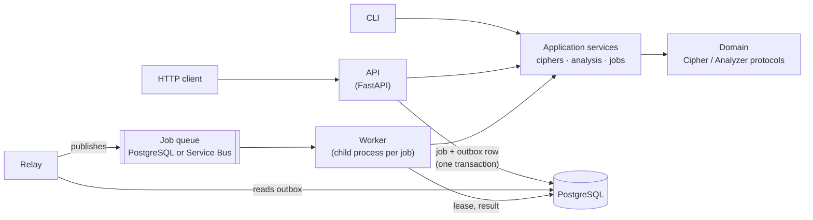

# Codebreakers

A typed Python service for encrypting, decrypting, and **breaking**
classical ciphers. One domain core powers a CLI and an HTTP API. Long-running
cryptanalysis runs as durable background jobs, and the whole system deploys
to Azure Container Apps with Terraform and GitHub Actions.

> **Security notice:** These ciphers provide **zero confidentiality**. They
> are broken by design, and this project exists to break them. Never use them
> to protect real secrets. Report vulnerabilities privately as described in
> [SECURITY.md](SECURITY.md). The [threat model](docs/security/threat-model.md)
> covers the hosted service.

## What it does

- **Four cipher families:** Caesar, monoalphabetic substitution, Vigenère, and
  homophonic substitution, with custom alphabets and case and punctuation
  preserved.
- **Four keyless analyzers:**
  - Caesar brute force, ranked by chi-square;
  - Vigenère key-length and key recovery;
  - substitution frequency reports;
  - homophonic token-distribution reports.

  Ranked candidates include scores and explanations; frequency reports include counts, frequencies, comparisons, and notes. See [domain.md](docs/domain.md) for how they work and where they fail.
- **Interfaces:** the `codebreakers` CLI, and a versioned FastAPI API with an
  OpenAPI 3.1 contract and RFC 9457 problem details.
- **Durable jobs:**
  - analyses are accepted with `202`, stored in PostgreSQL with a
    transactional outbox, and processed by separately scaled workers;
  - workers use leases, retries, dead-lettering, and per-job time and memory
    limits.
- **Operations:**
  - one container image runs every role;
  - Terraform provisions Azure Container Apps;
  - releases go to a zero-traffic revision, are smoke-tested, then receive
    traffic;
  - OpenTelemetry exports to Application Insights, and alerts have runbooks.

## Demo

```console
$ codebreakers encrypt --cipher vigenere --key LEMON --text "Attack at dawn"
Lxfopv ef rnhr

$ codebreakers encrypt --cipher caesar --key 7 < examples/passage.txt \
    | codebreakers analyze --analyzer caesar-bruteforce | jq '.candidates[0].key'
"7"

$ codebreakers encrypt --cipher vigenere --key LANTERN < examples/passage.txt \
    | codebreakers analyze --analyzer vigenere-frequency | jq '.candidate_keys[0].key'
"LANTERN"
```

```console
$ codebreakers serve &
$ curl -s -X POST localhost:8000/v1/analyses -H 'Content-Type: application/json' \
    -d '{"analyzer": "caesar-bruteforce", "text": "Wkh txlfn eurzq ira mxpsv ryhu wkh odcb grj"}'
{"id":"599ecacc-…","status":"pending",…}
$ curl -s localhost:8000/v1/analyses/599ecacc-…
{"id":"599ecacc-…","status":"succeeded",…,"result":{"kind":"ranked-candidates",…,"candidates":[{"rank":1,…,"key":"3","text":"THE QUICK BROWN FOX JUMPS OVER THE LAZY DOG",…
```

More:

- [examples/api.sh](examples/api.sh): every endpoint with curl, including
  errors;
- [CLI transcript](docs/media/cli-demo.md);
- [queued-analysis trace across services](docs/media/queued-analysis-flow.md);
- [OpenAPI screenshot](docs/media/openapi-docs.png).

## Architecture



- **Clean architecture:** the domain and application layers import no
  framework. The CLI, FastAPI, SQLAlchemy, queues, and telemetry are
  adapters behind ports ([ADR-0002](docs/architecture/ADR-0002-clean-architecture.md),
  [ADR-0015](docs/architecture/ADR-0015-cipher-and-analyzer-protocols.md)).
- **Jobs:** each job moves through a small state machine with
  optimistic-concurrency updates
  ([ADR-0016](docs/architecture/ADR-0016-analysis-job-state-machine.md)), so
  duplicate messages and crashed workers are safe
  ([ADR-0009](docs/architecture/ADR-0009-async-analysis-worker.md)).
- **Queue choice:** the queue is selected by configuration: in-process for
  `codebreakers serve`, PostgreSQL for the local stack and Azure `dev`, or
  Azure Service Bus (implemented and contract-tested).
- **Azure:** the API, relay, and worker run as three Container Apps from one
  image and scale to zero. Managed identity covers the registry, Key Vault,
  and telemetry, and GitHub OIDC handles delivery
  ([ADR-0012](docs/architecture/ADR-0012-azure-dev-environment.md),
  [ADR-0017](docs/architecture/ADR-0017-workload-and-delivery-identity.md)).

## Quick start

Requires Python 3.12+. Docker is needed for integration tests and the local
stack.

```bash
python -m venv .venv && source .venv/bin/activate
make install                      # editable install with dev tools + pre-commit hooks
codebreakers --help
codebreakers serve                # http://127.0.0.1:8000/docs, in-memory, no dependencies
examples/api.sh                   # in another shell: walk through the API with curl
```

To run the production-like stack (PostgreSQL, migrations, API, relay, and
worker):

```bash
docker compose up --build --wait  # or: make up
make smoke                        # health, encrypt, submit, worker completion, result
BASE_URL=http://127.0.0.1:8000 examples/api.sh
docker compose down               # add -v to delete the database volume
```

Copy [.env.example](.env.example) to `.env` to change settings. Every
variable is listed there.

> Upgrading from an older checkout? The database volume is now
> `postgres18-data`. A leftover `codebreakers_postgres-data` volume holds
> PostgreSQL 16 data that version 18 cannot read. Remove it with
> `docker volume rm codebreakers_postgres-data`.

## Tests and quality gates

| Command | What it runs |
| --- | --- |
| `make test` | Unit and Hypothesis property tests |
| `make integration` | PostgreSQL integration and migration tests (Testcontainers, needs Docker) |
| `pytest` | Everything, with coverage (gate: 80 %; currently ~94 %) |
| `make lint` / `ruff format --check .` | Ruff lint and format |
| `make typecheck` | `mypy --strict` on `src` and `tests` |
| `make scan-source` | Trivy: locked dependencies (fail on CRITICAL) and secrets |
| `make image image-check scan sbom` | Build; non-root/no-pip policy; Trivy image scan; CycloneDX SBOM |
| `make shutdown-check` | SIGTERM the running stack; assert clean exits |
| `make tf-check` | Terraform fmt, validate, mock-provider tests (dev + prod), Checkov |
| `make benchmark` | Analyzer and cipher timings ([benchmarks.md](docs/benchmarks.md)) |

CI runs the same commands as five parallel gates on every push and pull
request ([ci.yml](.github/workflows/ci.yml)). The committed API contract is
[docs/api/openapi.json](docs/api/openapi.json). A test fails when it drifts
from the code; regenerate it with `make openapi`.

## Using the CLI and API

```bash
codebreakers encrypt --cipher caesar --key 3 --text "HELLO WORLD"            # KHOOR ZRUOG
echo "KHOOR ZRUOG" | codebreakers decrypt --cipher caesar --key 3            # HELLO WORLD
codebreakers encrypt --cipher caesar --key 2 --text "1239" --alphabet "0123456789"   # 3451
codebreakers encrypt --cipher substitution --key QWERTYUIOPASDFGHJKLZXCVBNM --text "ATTACK"  # QZZQEA
codebreakers analyze --analyzer vigenere-frequency < ciphertext.txt          # JSON report
```

The CLI's exit codes are:

| Code | Meaning |
| --- | --- |
| 0 | Success |
| 1 | Unexpected error |
| 2 | Invalid usage or unsupported language |
| 3 | Invalid key |
| 4 | Invalid alphabet |
| 5 | Unsupported cipher |
| 6 | Unsupported analyzer |
| 7 | Insufficient text for analysis |

The routes of the HTTP API are:

| Route | Purpose |
| --- | --- |
| `POST /v1/ciphers/{cipher}/encrypt` · `…/decrypt` | Synchronous cipher operations |
| `POST /v1/analyses` | Submit an analysis; returns `202` with a `Location` header |
| `GET /v1/analyses/{id}` | Poll status and result |
| `GET /v1/analyses` | List jobs (disabled in Azure) |
| `GET /health/live` · `/health/ready` | Probes |

API limits:

- Request bodies are limited to 64 KiB and text to 20,000 characters.
- Each client IP may make 120 requests and 10 submissions a minute per
  replica; more get `429` with `Retry-After`.
- With 100 or more unfinished jobs, new submissions get `503`.
- Errors carry a stable `code` and the request's `correlation_id`.

Details:

- [ADR-0007](docs/architecture/ADR-0007-http-api-contract.md): the HTTP
  contract;
- [operations.md](docs/operations.md#configuration): configuration;
- [ADR-0008](docs/architecture/ADR-0008-analysis-persistence.md): retention.
  Source text is deleted when a job finishes, and results after 7 days.

## Deployment

Terraform in [infra/](infra/) provisions the Azure `dev` environment in
`westus3`:

- Container Apps for the API, relay, and worker, plus migration and
  retention jobs;
- PostgreSQL Flexible Server;
- Container Registry and Key Vault;
- Log Analytics and Application Insights;
- alerts and a budget.

Idle apps scale to zero. A public demo instance runs in `dev`. Its URL is
intentionally not published here.

- **First deployment:** follow the [Azure runbook](docs/operations/azure-runbook.md).
- **Releases:** a push to `master` passes the CI gates and then deploys
  through the *Deploy to dev* job. A `v*` tag publishes a release and
  deploys to `production` after approval
  ([ADR-0013](docs/architecture/ADR-0013-continuous-delivery.md)). The deploy
  job needs the GitHub `dev` environment to be connected first
  ([runbook §4](docs/operations/azure-runbook.md#4-connect-github-actions)).
- **Rollback, restore, alerts, cost, and teardown:** see
  [operations.md](docs/operations.md).

Measured on `dev` (2026-10-12):

- warm encrypt latency: p50 47 ms;
- queued Caesar job, warm: median 2.7 s;
- cold start: about 42 s.

See [benchmarks.md](docs/benchmarks.md) for the method and caveats.

## Documentation

| Document | Contents |
| --- | --- |
| [docs/domain.md](docs/domain.md) | Cipher abstractions, analyzers, scoring, limitations, historical sources |
| [docs/operations.md](docs/operations.md) | Configuration, deployment, migrations, observability, backup and restore, rollback, cost, teardown |
| [docs/architecture/](docs/architecture/README.md) | 17 architecture decision records, indexed by topic |
| [docs/benchmarks.md](docs/benchmarks.md) | Reproducible benchmarks and Azure measurements, with raw evidence |
| [docs/security/threat-model.md](docs/security/threat-model.md) | Threats, controls, and known gaps |
| [docs/operations/](docs/operations/) | Runbooks: Azure, rollback, restore, alerts, dead letters, credential compromise |
| [docs/media/](docs/media/README.md) | CLI transcript, queued-job trace, OpenAPI screenshot |
| [docs/portfolio.md](docs/portfolio.md) | Measured facts, architecture talk track, trade-offs, and claims not made |
| [TODO.md](TODO.md) | The phase-by-phase implementation plan and its exit criteria |

## Roadmap

### Completed

| Phase | Delivered |
| --- | --- |
| 0 | Engineering baseline: src layout, Ruff, strict mypy, pytest, pre-commit, ADRs |
| 1–2 | Caesar domain slice; the installable `codebreakers` CLI |
| 3 | Substitution, Vigenère, and homophonic ciphers; four analyzers; benchmarks |
| 4 | Versioned FastAPI API with an OpenAPI contract and problem details |
| 5 | PostgreSQL persistence, Alembic migrations, retention |
| 6 | Asynchronous jobs: outbox, relay, leased workers, retries, dead letters, Service Bus adapter |
| 7 | Hardened container image, Compose stack, image policy, Trivy, SBOM |
| 8 | Terraform for Azure Container Apps, PostgreSQL, Key Vault, and monitoring |
| 9 | OIDC delivery with staged rollout and rollback, OpenTelemetry, alerts, runbooks, threat model |
| 10 | This documentation, measurements, and portfolio evidence |

### Not done yet

- Run the automated *Deploy to dev* job live: connect the GitHub `dev`
  environment, then perform a live rollback drill and the alert tests.
- Provision `prod`, and tag `v1.0`.

### Future ideas

These are not commitments.

- Microsoft Entra authentication to PostgreSQL and private networking. These
  would close the two documented least-privilege gaps.
- Switch the deployed queue to Azure Service Bus once there is a reason to.
- User accounts with Entra ID, and saved jobs scoped to their owner.
- Stronger solvers: hill-climbing for substitution, and key recovery for
  homophonic ciphers.
- Language models beyond English.

## License

[MIT](LICENSE)
