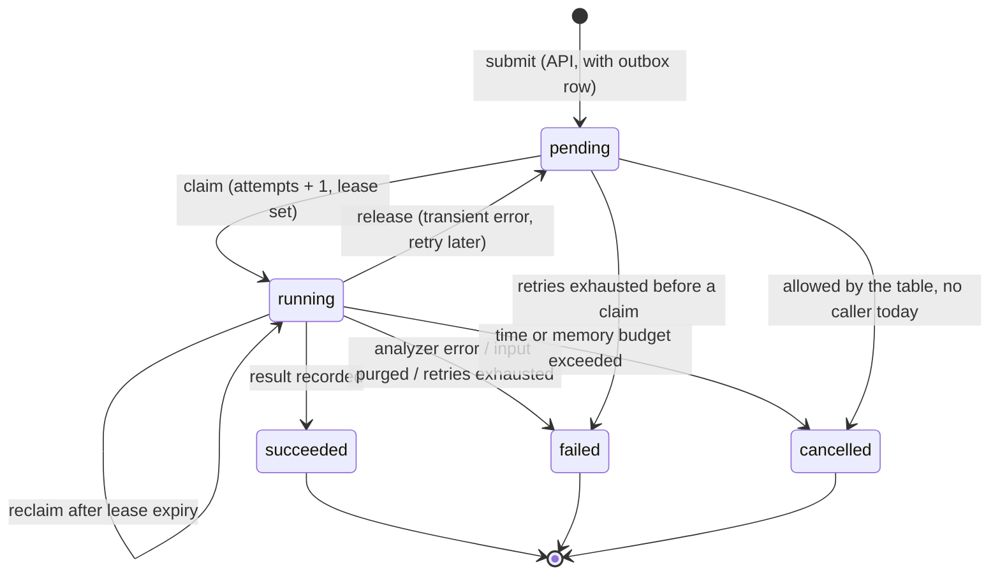

# ADR-0016: Analysis Job State Machine

## Status

Accepted. Recorded in Phase 10. It consolidates the lifecycle rules first
introduced in [ADR-0008](ADR-0008-analysis-persistence.md) and
[ADR-0009](ADR-0009-async-analysis-worker.md).

## Context

An analysis job is written by the API, at least one relay, and any number of
workers. Messages arrive at least once, workers can be killed mid-analysis,
and two workers can hold the same job if a lease lapses. The job state must
stay correct under all of these without long-held database locks.

## Decision

The lifecycle is an explicit state machine on the immutable `AnalysisJob`
value object (`application/analysis.py`). Every change returns a new object
with `version + 1`, and repositories persist it only if the stored version
still matches (optimistic concurrency).

- **Allowed transitions** are a single table (`_ALLOWED_TRANSITIONS`). Any
  other transition raises before reaching storage. Terminal states have no
  outgoing transitions.
- **Invariants are enforced by the value object:** `succeeded` requires a
  result, `failed` requires a stable `error_code`, and terminal states set
  `completed_at` and clear the lease.
- **Leases, not locks.** A claim sets `lease_expires_at` to the time budget
  plus a grace period. A `running` job whose lease has lapsed can be claimed
  again, which recovers work from a crashed worker. A slower worker's late
  result then fails the version check and is discarded.
- **Error classes map to states.** Analyzer errors are final (`failed`).
  Budget overruns are `cancelled`. Infrastructure errors release the job to
  `pending` for a bounded, backed-off retry.
- **Source text** is deleted in the same transaction as the terminal
  transition (ADR-0008).

## Alternatives considered

| Alternative | Why not |
| --- | --- |
| A status column that any code path may update | Invalid transitions, such as `succeeded` back to `running`, would be possible and only caught, if at all, by tests of each caller. |
| Database triggers or check constraints for transitions | The rules would live in SQL, outside the unit-testable domain, and be duplicated in the in-memory repository. |
| Row locks (`SELECT … FOR UPDATE`) held while analysing | A 30 s analysis would hold a transaction and a connection open. A crashed worker's lock only clears when its connection drops. |
| A workflow engine (Durable Functions, Temporal, Celery chords) | Too much infrastructure and vendor coupling for five states. Retries, leases, and dead letters are already provided by the queue adapters. |
| A public cancel endpoint | Deferred. Cancellation is internal (budget enforcement) until there are user accounts to authorize it. |

## Consequences

- Concurrency bugs surface as version conflicts, which the worker handles
  explicitly (defer or drop), instead of as silently overwritten results.
- The same rules hold for the in-memory and PostgreSQL repositories, because
  both persist the value object's output. Unit tests (`test_analysis_service.py`,
  `test_worker_processing.py`) cover every transition, including lease
  takeover and mid-job termination.
- Every write must read the current version first. That costs one extra read
  per duplicate message, which is acceptable at this scale.
