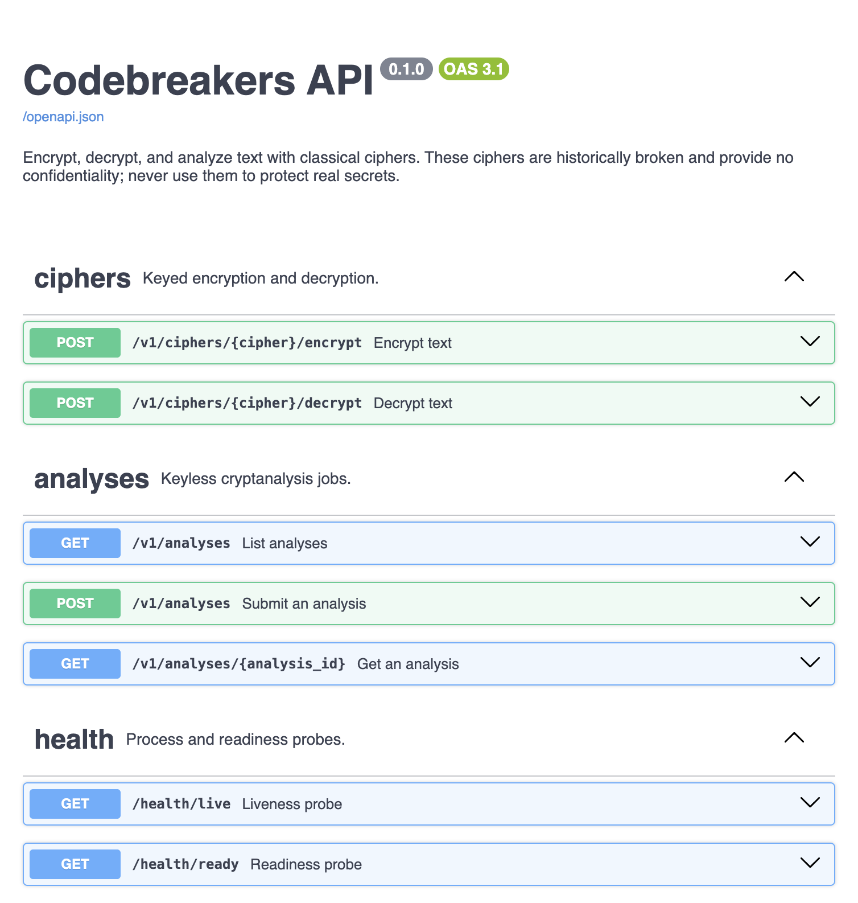

# Media and Demo Evidence

Captured artifacts that show the system working. Each one names the command
or setup that produced it, so it can be captured again.

| Artifact | What it shows | How it was captured |
| --- | --- | --- |
| [cli-demo.md](cli-demo.md) | Encrypting, decrypting, and keyless Caesar and Vigenère analysis, including a short-text failure | `codebreakers` CLI, 2026-10-12 |
| [queued-analysis-flow.md](queued-analysis-flow.md) | Submit → outbox relay → worker → result, with one correlation ID across services | `docker compose up` + [examples/api.sh](../../examples/api.sh), 2026-10-12 |
| [openapi-docs.png](openapi-docs.png) | The generated OpenAPI 3.1 reference at `/docs` | `codebreakers serve`, browser screenshot, 2026-10-12 |

## Screenshots still to capture

These need the Azure portal or GitHub and are taken by the project owner.
Before saving, crop or blur subscription IDs, tenant IDs, email addresses,
and the public API host name.

- [ ] **Application Insights, end-to-end transaction.** One `POST
  /v1/analyses` request with its SQL dependency spans and the worker's
  consumer span under the same operation ID. Save as
  `azure-app-insights-transaction.png`.
- [ ] **Application Insights, Logs.** The correlation-ID query from
  [ADR-0014 § Correlation](../architecture/ADR-0014-observability.md#correlation),
  showing API and worker rows for one request. Save as
  `azure-logs-correlation.png`.
- [ ] **Workbook.** The *Codebreakers service (dev)* workbook after some
  traffic: requests by status, latency percentiles, and jobs by outcome. Save
  as `azure-workbook.png`.
- [ ] **Container Apps, Revisions.** The API's revision list with the
  current and previous revisions both active and traffic at 100 / 0. Save as
  `azure-revisions.png`.
- [ ] **Alerts.** The alert rules list, or a fired test alert email with
  addresses hidden. Save as `azure-alerts.png`.
- [ ] **Cost Management.** The `rg-codebreakers-dev` cost analysis for the
  month, next to the budget. Save as `azure-cost.png`.
- [ ] **GitHub Actions, CI.** A green `CI` run graph on `master` showing every
  gate. Save as `github-ci.png`.
- [ ] **GitHub Actions, deploy.** A successful *Deploy to dev* job summary
  showing the candidate revision, the smoke test, and the traffic shift. This
  is possible only after the `dev` environment is connected
  ([Azure runbook §4](../operations/azure-runbook.md#4-connect-github-actions)).
  Save as `github-deploy.png`.
